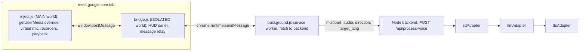

# Google Meet Two-Way AI Interpreter

## How it fits together



The extension is split into these pieces to get around the problems in the draft code:
- **Meet's page rules and CORS:** the fetch runs in the service worker, which has host permission for the backend, so Meet's `connect-src` policy and CORS don't apply.
- **Trusted Types:** the panel is built in the isolated world with `createElement` and `textContent`, never `innerHTML`.
- **Passing audio between scripts:** audio is sent across as an ArrayBuffer, then converted to base64 for `runtime.sendMessage`, because service-worker messages must be JSON-serializable.

## Folder layout

```
voice-chrome-extention/
  extension/
    manifest.json
    inject.js      # MAIN world, document_start
    bridge.js      # ISOLATED world, document_idle
    background.js  # service worker
    hud.css        # panel styles (normal CSS; no Tailwind build here)
  backend/
    package.json, tsconfig.json, .env.example
    src/server.ts
    src/routes/processVoice.ts
    src/services/aiService.ts
    src/adapters/stt/{index,openaiWhisper,groqWhisper,deepgram,customHttp}.ts
    src/adapters/llm/{index,openai,gemini,openaiCompatible}.ts   # openaiCompatible works for vLLM and Groq
    src/adapters/tts/{index,openai,elevenlabs,edgeTts,customHttp}.ts
    src/types.ts
  PROJECT_DOCUMENTATION.md
```

## Step 1: Extension manifest
- Two content scripts:
  - `inject.js` with `world: "MAIN"` and `run_at: "document_start"`.
  - `bridge.js` (isolated world) plus `hud.css`.
- `background.service_worker: background.js`.
- `permissions: ["storage"]`.
- `host_permissions`: `https://meet.google.com/*` and `http://localhost:3000/*`. The backend URL is configurable through `chrome.storage.local`.
- Check: load it unpacked, open Meet, and confirm all three scripts show up in DevTools.

## Step 2: Virtual mic in `inject.js`
- Wrap `navigator.mediaDevices.getUserMedia`. When `constraints.audio` is requested:
  - Open the real mic with the caller's own audio constraints (device ID, echo cancellation, and so on) and store it in `realMicStream`.
  - Lazily create one `AudioContext` and one `MediaStreamDestination` (no oscillator; the destination track stays live).
  - Return a new `MediaStream` containing the virtual audio track, plus real video tracks if video was requested.
- Replace the real mic whenever Meet asks again with a different device, and stop the old tracks.
- Resume the `AudioContext` on the first message from the panel, which only happens after a user click.
- Check: join a test meeting from a second device. It should hear silence, not your voice.

## Step 3: Push-to-talk recorders in `inject.js`
- **Outgoing:** a `MediaRecorder` on `realMicStream` using `audio/webm;codecs=opus`.
- **Incoming:**
  - Every time recording starts, collect all `audio` elements whose `srcObject` is set.
  - Feed each one into a single `MediaStreamDestination` with `createMediaStreamSource`, and record that mixed stream.
  - Use a `MutationObserver` to keep the list fresh as people join.
- Guards:
  - Ignore button presses while a request for the same direction is still running.
  - Discard clips under 300 ms.
  - Cap clips at 60 s and stop automatically.
- Check: log the clip size and length for each direction.

## Step 4: Playback in `inject.js`
- **Outgoing TTS:** decode with `decodeAudioData`, connect only to `virtualMicDest`, and queue clips one after another so they never overlap.
- **Incoming Bangla TTS:** play through `audioCtx.destination`. While it plays, lower Meet's `audio` elements to about 0.2 volume, then restore the original volume.
- Check: the remote device hears the Japanese/English voice, and you hear Bangla with Meet's audio turned down.

## Step 5: Message bridge
- Message protocol, every message tagged with `source: "meet-ai"`:
  - `START_REC` / `STOP_REC` with `{direction}`
  - `SET_LANG`
  - `STATUS`
  - `RESULT` with `{direction, transcript, translated_text, analysis}`
  - `ERROR`
- `bridge.js` only accepts messages where `event.source === window` and the tag matches.
- `background.js` builds `FormData` and POSTs it with a 30 s `AbortController` timeout. It returns the JSON, or `{error}` on failure.

## Step 6: HUD panel in `bridge.js` and `hud.css`
- Content:
  - A header with a JA/EN language `select`; the choice is saved in `chrome.storage`.
  - A "Speak Bangla" toggle button and a "Listen Client" toggle button.
  - A status line marked as a live region (`role="status"`, `aria-live="polite"`).
  - An analysis box showing the Bangla transcript and suggested reply points.
- States each button must handle:
  - idle, recording (red, with `aria-pressed="true"`), processing (disabled, with a spinner label), and error (inline message plus retry).
  - Empty state: "No client audio yet".
- Panel behavior:
  - It can be collapsed and dragged, and it sits above Meet's control bar.
  - Keyboard shortcuts for push-to-talk: Alt+B for speak and Alt+L for listen.
  - Buttons get visible focus rings.
  - It respects reduced-motion settings.
- Check: a keyboard-only pass, a screen reader announcing status changes, and a long Japanese transcript that wraps and scrolls instead of overflowing.

## Step 7: Backend in Node.js + TypeScript
- `POST /api/process-voice` uses `multer` (in memory, 10 MB limit).
- Fields: `audio`, `direction` (`outgoing` or `incoming`), and `target_lang` (`ja` or `en`, used for outgoing only).
- `aiService.process()` runs speech-to-text, then the LLM, then text-to-speech:
  - **Outgoing:** transcribe with `language: "bn"`, translate into the target language, synthesize in the target language. Analysis is optional.
  - **Incoming:** transcribe with automatic language detection, translate into Bangla and produce analysis, synthesize in Bangla.
- The LLM must return strict JSON `{ translated_text, analysis }`. Use JSON mode where the provider supports it, and fall back to parsing the first JSON object in the reply.
- Response: `{ transcript, detected_lang, translated_text, analysis, audio_base64, audio_mime }`.
- Adapter interfaces in `types.ts`:

```ts
export type SttAdapter = { transcribe: (audio: Buffer, mime: string, lang?: string) => Promise<{ text: string; lang: string }> }
export type LlmAdapter = { translate: (input: TranslateInput) => Promise<{ translated_text: string; analysis: string }> }
export type TtsAdapter = { synthesize: (text: string, lang: string) => Promise<{ audio: Buffer; mime: string }> }
```

- `STT_PROVIDER`, `LLM_PROVIDER` and `TTS_PROVIDER` choose the adapters at startup, and an unknown value stops the server immediately.
- The `customHttp` and `openaiCompatible` adapters read `CUSTOM_*_URL` and `CUSTOM_*_KEY`, so your own cloud AI services or vLLM can be plugged in.
- Edge-TTS goes through the `msedge-tts` npm package.
- Security and operations:
  - CORS is allowed only for the extension origin (`chrome-extension://<id>`, set from env).
  - Optional `API_TOKEN` bearer check.
  - API keys stay in env only and are never sent to the extension.
  - Audio is not written to disk.
  - Logs record the time taken by each stage.
  - `GET /health` reports status.
- `DEMO_MODE=true` returns canned results using a bundled short audio sample, so the extension can be tested end to end without any AI keys.
- Check: `curl -F audio=@sample.webm -F direction=incoming http://localhost:3000/api/process-voice`.

## Step 8: Documentation
- `PROJECT_DOCUMENTATION.md` covers setup, the env variable list, how to load the extension, how to add a new adapter, and known limits.

## Step 9: Paid OpenAI Stack & Simultaneous Continuous Streaming (Completed)
- **OpenAI STT (`whisper-1`):**
  - Resolved HTTP 400 when requesting language `"bn"` by automatically omitting the parameter on OpenAI to trigger internal Bengali language auto-detection.
  - Added Bengali script vocabulary primer prompt (`আসসালামু আলাইকুম...`) to ensure standard Bengali spelling and avoid Hindi/Devanagari scripts.
  - Fixed segment truncation (`data.text` preserved) so full sentences are translated without dropping start/end phrases.
- **OpenAI LLM (`gpt-4o-mini`):**
  - Added phonetic error recovery rules to map spoken transcription distortions to true speaker intent.
  - Enforced strict anti-truncation completeness and Tokyo business Keigo (です/ます調).
  - Removed false `unclear: true` rejections for uninterrupted conversation flow.
- **OpenAI TTS (`tts-1`):**
  - Replaced `gpt-4o-mini-tts` (12.2s latency) with `tts-1` (1.6s latency) for near-instant Japanese voice output.
- **Extension VAD & Streaming:**
  - Fixed VAD sensitivity lockup (clamped max threshold at 0.022 RMS and noise floor reset on cut).
  - Micro-chunking: 320ms pause, 2.8s soft-cut, 4.5s hard-cut for UN-style continuous interpretation.
  - High-fidelity 128kbps Opus recording.

## Expected end-to-end test
1. Join a meeting from two devices.
2. Outgoing: press Speak, say something in Bangla, release. The remote device should hear the JA/EN voice.
3. Incoming: the remote device speaks English. Press Listen, then release. You should hear Bangla and see the analysis.
4. Switch to real providers in `.env` and repeat.