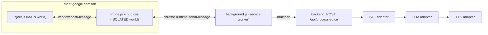

# Meet AI Interpreter

A Chrome extension (Manifest V3) that runs only in the host's Google Meet tab, plus a Node.js/TypeScript backend.
Remote participants join a normal Meet link and install nothing.

- **Outgoing:** you speak Bangla; Meet participants hear Japanese or English through your microphone.
- **Incoming:** clients speak Japanese or English; you hear Bangla in your headphones and see the transcript, translation and suggested reply points in a panel on the Meet screen.

Two modes, switchable in the panel:

- **Hands-free (default):** press once to go live. Each sentence is detected by a pause and translated while you keep talking.
- **Push-to-talk:** press once to start recording, press again to translate.

## Architecture



| File | Role |
| --- | --- |
| `extension/inject.js` | Wraps `getUserMedia` so Meet receives a virtual mic track; keeps the real mic for recording; mixes all remote `<audio>` streams for incoming recording; plays TTS into the virtual mic (outgoing) or your speakers with ducking (incoming). |
| `extension/bridge.js` | Builds the HUD (no `innerHTML`, because Meet enforces Trusted Types), relays clips to the service worker, stores settings. |
| `extension/background.js` | The only code that calls the backend, so Meet's `connect-src` CSP and CORS don't apply, and the API token never enters the page. |
| `backend/src/services/aiService.ts` | STT, then LLM, then TTS pipeline. |
| `backend/src/adapters/{stt,llm,tts}` | One file per provider, chosen by env vars. |

### Message protocol (window.postMessage, `source: "meet-ai"`)

| Direction | Type | Payload |
| --- | --- | --- |
| bridge to inject | `HELLO` | |
| bridge to inject | `START_REC` | `direction`, `mode` (`vad` or `ptt`), `silenceMs` |
| bridge to inject | `STOP_REC` | `direction` |
| bridge to inject | `PLAY` | `direction`, `audioBase64` |
| inject to bridge | `MIC` | `ready`, `muted` |
| inject to bridge | `STATUS` | `direction`, `state` (`recording`, `live`, `speech`, `silence`, `stopped`, `discarded`, `playing`, `played`) |
| inject to bridge | `CLIP` | `direction`, `buffer` (ArrayBuffer), `mime`, `durationMs`, `mode`, `seq` |
| inject to bridge | `ERROR` | `direction`, `message` |

## Setup

### 1. Backend

```bash
cd backend
npm install
cp .env.example .env      # DEMO_MODE=true works without any keys
npm run dev               # or: npm run build && npm start
curl http://localhost:3000/health
```

### 2. Extension

1. Open `chrome://extensions`, turn on **Developer mode**, click **Load unpacked**, and select the `extension/` folder.
2. Copy the extension ID. For anything beyond local testing, set `ALLOWED_ORIGINS=chrome-extension://<id>` in `backend/.env`.
3. Open a Meet call. The **AI Interpreter** panel appears at the bottom right. Turn on Meet's microphone once so the panel shows "Mic connected".
4. If the backend isn't at `http://localhost:3000`, or you set `API_TOKEN`, open **Settings** in the panel and enter them. A non-localhost backend also needs its origin added to `host_permissions` in `extension/manifest.json`.

After changing extension files, click reload on `chrome://extensions` and refresh the Meet tab.

## Using it

| Action | Button | Shortcut |
| --- | --- | --- |
| Start/stop both directions together (hands-free) | Start conversation (both ways) | Alt+C |
| Translate your Bangla into the selected language (JA/EN) | Speak Bangla / Start live: my Bangla | Alt+B |
| Translate the client's speech into Bangla + analysis | Listen to client / Start live: client | Alt+L |

### Hands-free mode

- **Start conversation (both ways)** turns on your outgoing Bangla and the client's incoming speech with one click; click again to stop both. If only one side is on, it starts the other.
- Press once to go live; the button turns red and reads "Live · listening". It changes to "hearing you…" while speech is detected. Press again to stop (the last words are still translated).
- **Outgoing with the OpenAI live interpreter (default engine)**: your mic is streamed continuously (24 kHz PCM, 200 ms frames) to `gpt-realtime-translate`. The client starts hearing Japanese/English about 1.5–2 s after you start talking, while you are still talking; there is no sentence cutting. The panel shows a live card with your Bangla (`gpt-realtime-whisper`) and the translation growing word by word.
- **Outgoing with the other engines** (Google / gpt-transcribe): a clip is cut after a natural pause (default 600 ms; Settings: 450 / 600 / 900 ms). Long speech is cut at a short breath pause after 9 s, and hard-cut at 15 s.
- Requests run in parallel, and audio is synthesized and played into the virtual microphone in the exact order spoken.
- **Settings → I'm using headphones** (on by default): you are heard even while the client's Bangla voice plays. Turn it off with speakers, so outgoing capture pauses while Bangla plays and the client's voice is never translated back to them. Outgoing also pauses while Meet's own mic is muted.

### Push-to-talk mode

While recording, the button turns red and reads "Stop and translate". While the backend works, it shows a spinner and is disabled. Clips under 300 ms are discarded; recordings stop automatically at 60 s.

Failed requests in either mode show the error with a **Retry** link that resends the same clip.

### Translation quality and speed

- **Settings → Translate my Bangla with**:
  - `OpenAI live interpreter` (default, hands-free only): simultaneous speech-to-speech translation, about $0.034 per minute while on.
  - `OpenAI sentence by sentence`: each clip goes to `gpt-transcribe` with `language=bn`, then `gpt-4o-mini`, then TTS. Push-to-talk always uses this path.
  - `Google`: Chrome's built-in recognition (`bn-BD`, computer's default microphone).
  - Client audio (JA/EN → Bangla) always uses captions or the backend; the live interpreter can't output Bangla.
- Each result may show "Understood as:" when the translator fixed an obvious recognition error. The translator is told to translate exactly what was said: no added or dropped content, no invented greetings.

- The last 6 transcripts (yours and the client's) are sent with each clip as context, so the translator can resolve "it/that" and correct misheard words. Context lives only in the tab's memory and is cleared on refresh.
- **Settings → Read the client's words aloud in Bangla**: turn it off to get the Bangla text only, about 1 second faster.
- `STT_GLOSSARY` lists names and terms (people, company, product, tech words). Whisper uses it, plus the speaker's previous sentence, as a spelling hint, and the translator treats them as known names.
- **Settings → Get the client's words from**: `Meet captions` (default) reads Meet's own live captions instead of sending meeting audio to Whisper. This is more accurate, shows the speaker's name, and handles several client speakers. Turn on **CC** in Meet and set the caption language to the client's language (Japanese or English). If no captions are found within 3 seconds, the panel says so. What the client is saying appears live under the buttons. Each sentence is sent about 0.4 s after Meet ends it with punctuation, even while the client keeps talking; unpunctuated speech is sent after the pause setting plus 0.3 s. Captions are used in hands-free mode only; push-to-talk always uses Whisper. Selectors live at the top of `extension/captions.js`, and need updating if Meet changes its markup.
- **Long translations** are spoken sentence by sentence. The first sentence's voice arrives with the translation, and the rest are synthesized in parallel and played in order, so a long answer starts about as soon as a short one.
- **Settings → Voice speed** (Slower, Slightly slower, Normal, Faster) applies to both voices. Edge, OpenAI and ElevenLabs honor it; the Google Translate fallback voice always speaks at normal speed.
- **Summarize meeting** turns this tab's translations (up to the last 300) into minutes in Bangla then English: summary, decisions, action items, client requests, open questions. Copy or download it as a `.txt` file. History is kept in tab memory only and is lost on refresh, so summarize before leaving the call.

## Recent Enhancements & Continuous Interpretation Pipeline (নতুন ফিচার ও অপ্টিমাইজেশনসমূহ)

> [!IMPORTANT]
> **v1.2.0 update (live interpreter).** Testing showed that several earlier changes listed below caused missing or invented words, and they have been reverted:
> - `whisper-1` does not support Bangla. With `language=bn` it returns HTTP 400; without it, it produces wrong-script text and takes ~13 s.
> - The Bangla vocabulary primer made Whisper echo or invent text.
> - The "phonetic decoder" prompt rewrote correct words (e.g. `কত` → `কথা`).
> - The 2.8 s / 4.5 s hard cuts split words in half.
>
> What replaced them:
> - **STT:** `gpt-transcribe` with `language=bn` ("আমি আসতেছি" transcribed exactly in ~1.9 s).
> - **Translator prompt:** faithful-interpreter rules.
> - **Hands-free outgoing:** the OpenAI live interpreter (`gpt-realtime-translate`, below).
>
> Sections 2–4 are kept as history.

### 0. Two-Way Continuous Interpretation Pipeline (v1.3.0)

Both outgoing and incoming audio operate completely hands-free with high speed and zero manual language switching:

1. **Host Outgoing (Bangla → Japanese / English Live):**
   - **Engine:** `gpt-realtime-translate` connected via WebSocket (`/ws/translate`).
   - **Continuous Audio Stream:** Real mic is captured via `inject.js`, converted to 24 kHz mono PCM16, and streamed in real time.
   - **Refined Japanese Speech & Colloquial Tolerance:**
     - Prompt handles spoken Bengali colloquial inflections (`আসতেছি, করতেছি, যাইতেছি, করসি, দেখসি`) and maps them accurately into polite Tokyo Japanese (`丁寧語 / です・ます調`).
     - Tech and business vocabulary (ডিজাইন, টেস্ট রিপোর্ট, ডেডলাইন, ফিচার, কোটেশন) are preserved and translated contextually.
   - **Low Latency:** Translated Japanese/English audio streams directly into the virtual Meet microphone while you are still speaking (~1.5–2s initial latency, continuous playback thereafter).

2. **Client Incoming (Japanese / English Auto-Detect → Bangla Voice):**
   - **Engine:** `gpt-realtime-whisper` connected via WebSocket (`/ws/transcribe`).
   - **Meeting Audio Capture:** Remote participant `<audio>` elements are mixed and streamed directly to backend Whisper transcription.
   - **Seamless Multi-Language Handling:**
     - Client can freely speak in **either Japanese or English** (or switch mid-call).
     - OpenAI's `gpt-realtime-whisper` automatically transcribes the incoming speech in real time without being forced into a single fixed language.
   - **Sentence Chunking & Parallel Translation:**
     - `realtimeTranscribe.ts` chunks continuous incoming speech into natural punctuation-based sentences (`。！？.!?`).
     - Each completed sentence is dispatched immediately to `gpt-4.1-mini` (latency ~1.5s) for natural Bangladeshi Bengali translation.
     - IT terms (API, backend, bug, test, deadline, deployment) remain in natural phonetic Bengali script.
     - Voice is synthesized via low-latency Bengali Edge TTS (`bn-BD-NabanitaNeural`) and played directly to the host's headphones.
   - **Decoupled Analysis:** Conversational analysis runs in the background in parallel and never blocks the translated speech playback.

### 1. Paid OpenAI Pipeline & Latency Optimization
- **Official OpenAI Stack:** paid OpenAI endpoints: `gpt-transcribe` for Bangla STT (was `whisper-1`, which can't do Bangla), `gpt-4o-mini` for translation/reasoning, `tts-1` for audio synthesis, and `gpt-realtime-translate` for the live interpreter.
- **TTS Latency Breakthrough (12.2s → 1.6s):**
  - Replaced the conversational audio model `gpt-4o-mini-tts` (which had a high ~12.2-second generation latency) with OpenAI's dedicated low-latency `tts-1` model (`voice: ash`).
  - Audio generation time dropped from **12,200 ms down to ~1,600 ms** for natural Japanese speech.
- **Configuration Defaults:** Updated `backend/src/config.ts` and `backend/.env` to default to `OPENAI_TTS_MODEL=tts-1`, `OPENAI_TTS_VOICE=ash`, and `TTS_PROVIDER_JA=openai`.

### 2. Whisper Bengali Speech-to-Text (STT) Enhancements
- **OpenAI HTTP 400 Fix for Bengali (`bn`):**
  - OpenAI's `/v1/audio/transcriptions` API rejects ISO 639-1 code `"bn"` with an HTTP 400 error.
  - The adapter (`backend/src/adapters/stt/openaiWhisper.ts`) now automatically detects when running against OpenAI with language `"bn"` and omits the `language` query parameter. This triggers Whisper's internal language classifier to recognize Bengali automatically (`detected: bengali`).
- **Bengali Script Priming (Prompt Bias):**
  - Injected realistic conversational Bengali greetings and business vocabulary directly into Whisper's prompt primer (`"আসসালামু আলাইকুম, কেমন আছেন? কোম্পানি, প্রজেক্ট, মিটিং, কাজ, সমস্যা..."`).
  - This prevents Whisper from transliterating Bengali speech into Devanagari/Hindi phonetics or hallucinating unrelated words.
- **Prevention of Dropped Sentences & Truncation:**
  - Previously, Whisper segments with `no_speech_prob > 0.6` were discarded, which often cut off the beginning or ending of user utterances.
  - Replaced with a full-text preservation strategy (`data.text`), ensuring that the complete sentence spoken by the user is passed to the LLM without missing segments.

### 3. Intelligent LLM Translation & Japanese Business Keigo (Prompt Engineering)
- **Phonetic Error Tolerance & Intent Recovery (`backend/src/adapters/llm/prompt.ts`):**
  - Spoken Bengali through audio STT often has minor phonetic mishearings (e.g., *'স্টনামারেকম্'* for *'আসসালামু আলাইকুম'*, *'পাম্পানের'* for *'কোম্পানির'*, *'কাথা গে সুনা জাচে'* for *'কথা কি শোনা যাচ্ছে'*, *'পলিস'* for *'পাবলিশ'*).
  - Configured `gpt-4o-mini` as an intelligent phonetic decoder with specific domain recovery rules to reconstruct the speaker's true intent accurately.
- **Eliminated False "Couldn't Understand" Rejections:**
  - Removed the overly strict condition that triggered `unclear: true` ("Couldn't understand this..."). The LLM now translates the core intent of all natural spoken phrases without interrupting the speaker.
- **Completeness Enforcement:**
  - Added strict prompt guidelines: *"Translate the entire message completely from beginning to end. Never skip, truncate, or omit the first part or the last part."*
- **Natural Tokyo Business Keigo (丁寧語 / です・ます調):**
  - Translations to Japanese now follow polite Tokyo business standards with proper greeting phrases (`お世話になっております`) and smooth conversational connectors (`〜ので, 〜ですが`), ensuring corporate-grade meeting communication.

### 4. Continuous Streaming VAD & Mic Sensitivity Fixes (Extension)
- **VAD Sensitivity Lockout Fix (First Sentence Freeze Bug):**
  - **Issue:** In hands-free mode, after speaking the first sentence, the microphone's dynamic noise floor drifted upward from `0.005` to `0.05` RMS, and the speech threshold climbed to `0.14 RMS`. This caused the extension to become deaf to subsequent speech until toggled off and on.
  - **Solution:** Clamped `maxThreshold: 0.022`, `maxNoiseFloor: 0.008`, `noiseFactor: 2.0`, and added an automatic dynamic reset `session.noiseFloor = 0.004` on every cut segment. The microphone now maintains full, consistent sensitivity continuously.
- **Rapid Micro-Chunking for Continuous Non-Stop Speaking:**
  - Sliced speech into rapid natural segments:
    - **Default pause:** Reduced from `700ms` to `320ms` for immediate end-of-sentence detection.
    - **Soft Max Cut:** Reduced from `12,000ms` down to `2,800ms` (triggered by a tiny `120ms` breath pause), splitting long continuous speech into bite-sized 2-3s chunks.
    - **Hard Max Cut:** Reduced from `20,000ms` down to `4,500ms` to guarantee chunks are streamed even without pauses.
    - **Minimum speech:** `120ms` to prevent dropping short confirmations.
- **High-Fidelity Audio Stream:**
  - Configured Opus recording at `audioBitsPerSecond: 128_000` (128 kbps) in `RECORDER_OPTIONS` (`extension/inject.js`) to provide studio-grade vocal fidelity to Whisper STT.
- **UI Settings Presets (`extension/bridge.js`):**
  - Set default engine to `Whisper` and default pause to `320ms`.
  - Added streamlined pause options in settings dropdown: `250ms (Ultra fast)`, `320ms (Continuous)`, `450ms (Balanced)`, and `700ms (Paced)`.

## Environment variables

See [`backend/.env.example`](backend/.env.example) for the full list with defaults. Values in `backend/.env` take precedence over variables already set in the shell (for example a global `OPENAI_API_KEY`), so change settings such as `PORT` in `.env`, not on the command line.

| Variable | Values |
| --- | --- |
| `DEMO_MODE` | `true` returns canned text and a chime sound, with no providers called |
| `STT_PROVIDER` | `openai`, `groq`, `deepgram`, `custom` |
| `LLM_PROVIDER` | `openai`, `gemini`, `openai-compatible` (aliases `vllm`, `custom`) |
| `TTS_PROVIDER` | `openai`, `elevenlabs`, `edge`, `custom` |
| `TTS_FALLBACK_PROVIDER` | Backup voice used when the main one fails, default `google-translate` (free, unofficial, plainer voice); `none` disables it. After an HTTP 429 the main voice is skipped for 60 s. If every voice fails, the response still carries the text, with `voice_error` set |
| `TTS_PROVIDER_BN` / `_JA` / `_EN` | Optional per-language override, e.g. `TTS_PROVIDER_JA=openai` for a paid Japanese voice while Bangla stays on `edge` |
| `EDGE_TTS_VOICE_JA` / `_EN` / `_BN` | Edge voice names. Defaults: `ja-JP-KeitaNeural`, `en-US-AndrewMultilingualNeural`, `bn-BD-NabanitaNeural` |
| `OPENAI_TTS_INSTRUCTIONS` | Speaking style for `gpt-4o-mini-tts` (calm, friendly professional by default) |
| `CUSTOM_LLM_REASONING_EFFORT` | `low`, `medium`, `high` for reasoning models such as `openai/gpt-oss-120b`; `low` is about 0.3 s faster |
| `STT_GLOSSARY` | Names and terms speech recognition should spell correctly |
| `API_TOKEN` | Optional bearer token, checked in constant time |
| `ALLOWED_ORIGINS` | Comma-separated allowed `Origin` headers. Requests from other origins get a 403, which blocks web pages from spending your API credits via localhost |
| `OPENAI_STT_MODEL` | Default `gpt-transcribe` (supports Bangla). `whisper-1` does not support Bangla |
| `OPENAI_REALTIME_TRANSLATE_MODEL` | Live interpreter model, default `gpt-realtime-translate` |
| `OPENAI_REALTIME_TRANSCRIBE_MODEL` | Live transcript of your Bangla, default `gpt-realtime-whisper` |
| `OPENAI_REALTIME_TRANSLATE_URL` | Default `wss://api.openai.com/v1/realtime/translations` |
| `OPENAI_REALTIME_NOISE_REDUCTION` | `near_field` (headset/laptop mic, default), `far_field`, or `off` |

An unknown provider name or a missing required key stops the server at startup with a clear error.

### Plugging in your own cloud AI

- **STT** (`STT_PROVIDER=custom`): `POST CUSTOM_STT_URL`, multipart `audio` (+ `language` for Bangla), returns JSON `{ "text": "...", "lang": "ja" }`. An OpenAI-compatible Whisper server (faster-whisper-server, speaches) can instead use `STT_PROVIDER=openai` with `OPENAI_BASE_URL` pointed at it.
- **LLM** (`LLM_PROVIDER=vllm`): `CUSTOM_LLM_URL=http://host:8000/v1`, `CUSTOM_LLM_MODEL=Qwen/Qwen2.5-7B-Instruct`. Set `CUSTOM_LLM_JSON_MODE=false` if the server rejects `response_format`.
- **TTS** (`TTS_PROVIDER=custom`): `POST CUSTOM_TTS_URL`, JSON `{ "text", "lang", "rate" }` (`rate` 1 is normal speed), returns `audio/*` bytes or JSON `{ "audio_base64", "mime" }`.

### API contract

`POST /api/process-voice` (multipart): `audio` (file) or `text` (already recognized speech, up to 1000 characters; skips STT), `direction` (`outgoing` or `incoming`), `target_lang` (`ja` or `en`, used for outgoing), optional `tts` (`off` skips speech; `audio_base64` is then empty), optional `voice_rate` (0.7–1.3, default 1), optional `context` (JSON `[{ "speaker": "host" | "client", "text": "..." }]`, last 6 turns, 300 characters each; malformed values are ignored).

`audio_base64` holds the first sentence only. `remaining_sentences` lists the rest, to be fetched with `/api/tts` in `voice_lang` and played in order.

`POST /api/tts` (JSON): `{ "text", "lang": "bn" | "ja" | "en", "voice_rate" }` returns `{ "audio_base64", "audio_mime" }`.

`POST /api/summary` (JSON, up to 300 turns): `{ "turns": [{ "speaker": "host" | "client", "name", "text", "translation" }] }` returns `{ "summary": "..." }` as plain text, Bangla first then English. Demo mode returns a fixed sample (`/api/tts` returns 503 there).

`GET /ws/translate?target=ja|en&token=…` (WebSocket, live interpreter; same origin and token checks as the HTTP API):
- **Client → server:**
  - `{ "type": "audio", "audio": base64 }`: 24 kHz mono PCM16, 200 ms frames, sent continuously including silence.
  - `{ "type": "stop" }`
- **Server → client:**
  - `ready`
  - `status` (`reconnecting` / `connected`)
  - `source_delta` and `translation_delta` (`delta`, append-only text)
  - `audio` (`audio` base64 PCM16, `sampleRate`)
  - `error` (`message`, `fatal`)
  - `closed` (`reason`)
- `/health` reports `live.available`.

```json
{
  "transcript": "When do you expect the project to be completed?",
  "detected_lang": "en",
  "translated_text": "প্রজেক্ট কবে নাগাদ শেষ হবে বলে আশা করছেন?",
  "analysis": "ক্লায়েন্ট সময়সীমা জানতে চাইছেন।\n• ...",
  "audio_base64": "...",
  "audio_mime": "audio/mpeg",
  "empty": false,
  "timings": { "stt_ms": 420, "llm_ms": 610, "tts_ms": 900, "total_ms": 1930 }
}
```

`empty: true` means no speech was detected. `unclear: true` means the transcript was too garbled to translate safely (`translated_text` and audio are empty). `understood` is the translator's corrected reading of outgoing Bangla. Errors return `{ "error": "..." }` with 400 (bad input), 401 (token), 403 (origin), 413 (too large), 502 (provider failed) or 500.

## Adding a provider

1. Create `backend/src/adapters/<kind>/<name>.ts` exporting a factory `(config) => SttAdapter | LlmAdapter | TtsAdapter` (interfaces in `src/types.ts`). Use `providerFetch` from `src/lib/http.ts` for timeouts and safe error messages.
2. Add its env vars to `src/config.ts` and `.env.example`, and validate required ones with `requireValue`.
3. Register it in `backend/src/adapters/<kind>/index.ts`.

## Verification checklist

1. Run the backend with `DEMO_MODE=true` and load the extension.
2. Join a meeting from a second device (phone or another browser profile).
3. Without pressing anything, speak: the second device hears silence.
4. Press Speak Bangla, talk, press again: the second device hears the chime (demo) or the JA/EN voice (live).
5. Speak on the second device, press Listen to client and then press it again: you hear the response and see the Bangla text and analysis.
6. Switch `.env` to real providers, restart, and repeat.

## Known limits

- STT, LLM and TTS run in sequence, about 2-3 seconds per sentence after you pause (hands-free). In push-to-talk the whole turn must finish first.
- Hands-free detection runs on a page timer; if Chrome throttles the Meet tab in the background (it normally doesn't while a call is playing audio), cuts become less precise.
- Meet's DOM and media handling can change; the virtual mic depends on Meet calling `getUserMedia` after the extension loads (it runs at `document_start`).
- **Anything played into the virtual mic is heard by everyone in the meeting.** Meet's own mute button also mutes the translated voice.
- Incoming capture records everyone in the meeting except you, mixed together. With Meet captions, each speaker is translated separately, but caption accuracy depends on Meet and on the caption language being set correctly.
- Edge-TTS uses an unofficial Microsoft endpoint. It rate-limits (HTTP 429) clients that open many connections quickly; the backend keeps one connection per voice to avoid this. Use a paid TTS for client-critical calls.
- Multilingual Edge voices (`…MultilingualNeural`) sound the most natural but take about 1 s per sentence, versus about 0.35 s for regular voices such as `ja-JP-KeitaNeural`.
- Groq Whisper's Bangla recognition is imperfect (merged or misspelled words). The translator compensates using context, but unusual names still need `STT_GLOSSARY`.
- Check that your chosen STT and TTS models support Bangla (for example Deepgram and ElevenLabs model coverage differs).
- Audio is processed in memory only and never written to disk; provider data handling follows each provider's own policy.
